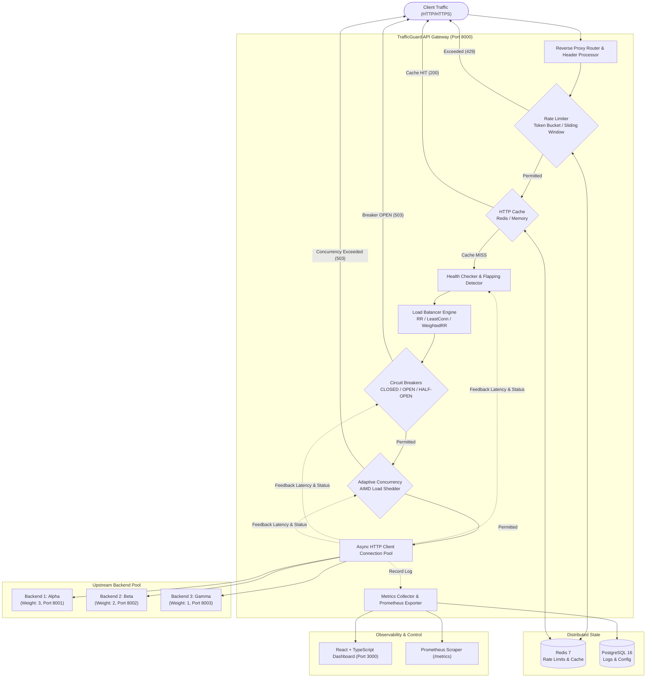
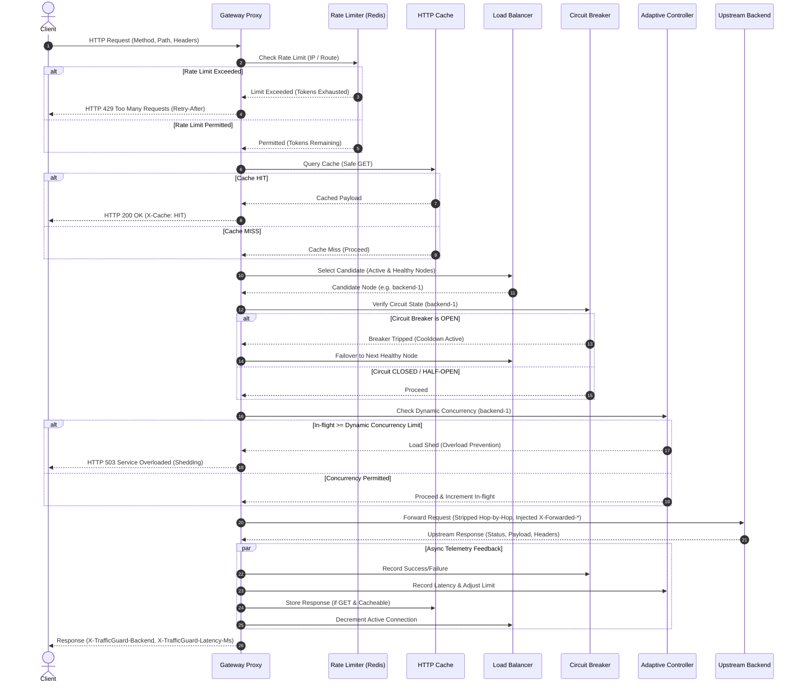

# TrafficGuard Architecture & Systems Specification

## 1. Architectural Overview

**TrafficGuard** is an adaptive traffic management, reverse proxy, and resilience platform designed to protect distributed microservices from cascading failures, traffic spikes, and slow downstreams.

Unlike static reverse proxies, TrafficGuard integrates active telemetry feedback loops between request execution, failure detection, dynamic concurrency control, and rate limiting.

---

## 2. Request Lifecycle & Decision Tree

When a request enters TrafficGuard (`/api/v1/proxy/{path}`), it passes through seven distinct protective gates before touching downstream servers:

---

## 3. Core Subsystems & Algorithmic Design

### 3.1 Load Balancing Engine (`gateway/core/load_balancer.py`)
Modular strategy pattern supporting dynamic hot-swapping at runtime:
1. **Round Robin**: Thread-safe index increment modulo healthy backend count ($O(1)$).
2. **Least Connections**: Dynamically inspects `active_connections` map, routing to the candidate with minimum in-flight load.
3. **Smooth Weighted Round Robin (Nginx Algorithm)**:
   - For all available nodes: $current\_weight_i \leftarrow current\_weight_i + effective\_weight_i$
   - Select node $k$ with maximum $current\_weight_k$.
   - Decrement selected node: $current\_weight_k \leftarrow current\_weight_k - \sum effective\_weights$.
   - **Advantage**: Avoids burst-clustering where high-weight nodes receive all requests consecutively.

### 3.2 Active & Passive Health Checker (`gateway/core/health_checker.py`)
- **Active Polling**: Background asyncio task asynchronously pings `/health` endpoints at configurable intervals (`HEALTH_CHECK_INTERVAL_SECONDS = 3.0s`).
- **Consecutive Thresholds**:
  - `unhealthy_threshold = 3`: 3 consecutive failures mark node as `UNHEALTHY`.
  - `healthy_threshold = 2`: 2 consecutive successes required to restore node to `HEALTHY`.
- **Flapping Detection & Dampening**:
  - Tracks state flips ($HEALTHY \leftrightarrow UNHEALTHY$) in a rolling window of 60s.
  - If state flips $\ge 3$, the backend is flagged as **FLAPPING**.
  - Imposes an exponential dampening quarantine (`FLAPPING_PENALTY_SECONDS = 30.0s`). During quarantine, the node is barred from routing even if ping probes return 200 OK.

### 3.3 Distributed Rate Limiting (`gateway/core/rate_limiter.py`)
- **Token Bucket Algorithm**:
  - Refills tokens at steady rate $r$ up to capacity $C$.
  - Atomic Redis Lua script prevents race conditions across multi-worker deployments.
- **Sliding Window Log Algorithm**:
  - Redis sorted set (`ZADD`, `ZREMRANGEBYSCORE`, `ZCARD`) calculating exact request timestamps in rolling window $[now - window, now]$.
- **Graceful Fallback**: In-memory high-precision fallback when Redis is absent.

### 3.4 3-State Circuit Breaker (`gateway/core/circuit_breaker.py`)
- **CLOSED**: Traffic passes freely. Consecutive failures are tracked.
- **OPEN**: Tripped when failure threshold (4 consecutive failures or >50% failure rate) is breached. All requests fail fast with `HTTP 503` without contacting backend.
- **HALF-OPEN**: Initiated when `recovery_timeout` (8.0s) elapses. Permits a limited trial budget (3 probe requests).
  - If all probe requests succeed $\rightarrow$ transitions to **CLOSED**.
  - If ANY probe fails $\rightarrow$ immediately trips back to **OPEN** with extended cooldown.

### 3.5 Adaptive Traffic Controller (`gateway/core/adaptive_controller.py`)
- **Signals**: Monitors rolling $P_{95}$ latency and rolling error rate.
- **AIMD Dynamic Concurrency**:
  - When $P_{95} \le \text{SLA Target (120ms)}$ and Error Rate $< 5\%$:
    $$\text{Limit}_{new} = \min(\text{Limit}_{max}, \text{Limit} + 1)$$
  - When $P_{95} > \text{Max SLA (350ms)}$ or Error Rate $\ge 15\%$:
    $$\text{Limit}_{new} = \max(\text{Limit}_{min}, \lfloor \text{Limit} \times 0.7 \rfloor)$$
- **Explainability**: Every decision creates an auditable record logging timestamp, action, reason, previous limit, new limit, and observed metrics.

### 3.6 HTTP Caching Engine (`gateway/core/cache.py`)
- **Cache Key**: SHA-256 hash of `METHOD:PATH:SORTED_QUERY_PARAMS`.
- **Safety**: Automatically bypasses requests with `Authorization`, session cookies, or `Cache-Control: no-cache`. Responses with `Set-Cookie` or `Cache-Control: private` are never stored.
