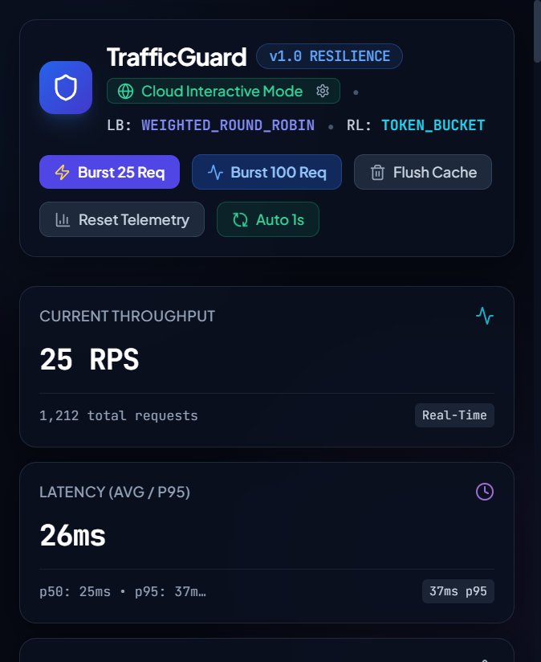
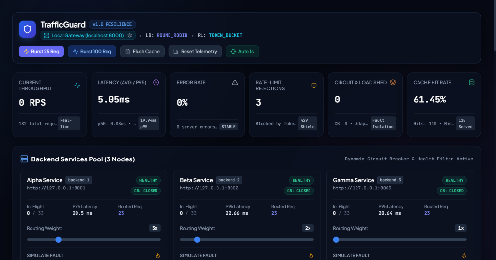

# TrafficGuard — Adaptive Traffic Management & Resilience Platform

[](https://python.org)
[](https://fastapi.tiangolo.com)
[](https://react.dev)
[](https://trafficguard-vishesh9910.vercel.app)
[](https://docker.com)
[-brightgreen.svg)]()

**TrafficGuard** is an intelligent, production-ready API gateway and reverse proxy platform designed to protect distributed microservices against cascading failures, unexpected traffic surges, failing downstreams, and degraded servers.

🌐 **Live Vercel Production Deployment:** [https://trafficguard-vishesh9910.vercel.app](https://trafficguard-vishesh9910.vercel.app)

[](https://vercel.com/new/clone?repository-url=https%3A%2F%2Fgithub.com%2FTHAKURSAHAB9910%2FTrafficGuard)


---

## 🖥️ Live Dashboard Tour & Overview

[](https://trafficguard-vishesh9910.vercel.app)

TrafficGuard includes an interactive, production-grade telemetry and resilience dashboard built with **React 18**, **TypeScript**, and **Tailwind CSS**. It provides comprehensive real-time visibility and active controls across the traffic pipeline:

- **6 KPI Metric Cards Grid**:
  - **Throughput**: Real-time requests per second (RPS) and total request counter.
  - **Latency (Avg / p95)**: Dynamic percentile calculations ($P_{50}, P_{95}, P_{99}$, Min, Max).
  - **Error Rate**: Automated calculation of 4xx/5xx failure rates with status indicators (`STABLE` vs `ELEVATED`).
  - **Rate-Limit Rejections**: Real-time counter of blocked abusive requests (`429 Shield`).
  - **Circuit Breaker & Load Shed**: Isolated requests blocked by tripped circuit breakers or AIMD concurrency caps.
  - **Cache Hit Rate**: Live cache ratio with hits, misses, and bypass counters.
- **Dynamic Load Balancing Strategy Switcher**:
  - Live multi-segment visual progress bar displaying real-time traffic distribution across nodes.
  - 1-click strategy toggle between **Round Robin**, **Least Connections**, and **Smooth Weighted Round Robin**.
- **Backend Service Fleet with Runtime Fault Injection**:
  - Node cards for all 3 backends displaying current routing weight, active in-flight requests, and $P_{95}$ latency.
  - Real-time health status pills (`HEALTHY`, `UNHEALTHY`, `FLAPPING`) and circuit breaker badges (`CLOSED`, `OPEN`, `HALF_OPEN`).
  - Live weight sliders ($1\times - 10\times$) for dynamic traffic reweighting.
  - **1-Click Chaos Buttons**: Inject `+400ms` latency, simulate `60% Err` to trip breakers, `Crash/Revive` nodes to test failover, and `Reset` backends.
- **Adaptive Concurrency Control (AIMD)**:
  - Real-time specification display (Target SLA 120ms, Breach 350ms, Backoff $0.7\times$, Recovery $+1/\text{sec}$).
  - **Explainable Decision Audit Log**: Live audit feed displaying automatic `SHED`, `EXPAND`, and `HOLD` actions with timestamp, node ID, observed latency, and previous vs new limit.
- **Dual-Mode Connectivity**:
  - **Cloud Interactive Mode**: Autonomous, zero-dependency browser simulation engine preloaded with 3 backends and live traffic generation for instant evaluation on Vercel.
  - **Local Gateway Mode**: Connects directly to `http://localhost:8000` (Docker or local FastAPI gateway) with 1-click switching in the header.

It sits between clients and multiple upstream backend services, actively distributing load, detecting failures, enforcing distributed rate limits, isolating unhealthy services via circuit breakers, and dynamically shedding load using adaptive concurrency control.

---

## 1. Key Features

- **Real Asynchronous Reverse Proxy**: Custom reverse proxy built with FastAPI and `httpx` connection pooling. Preserves headers (`X-Forwarded-For`, `X-Forwarded-Proto`, `X-Request-ID`), strips hop-by-hop headers, handles timeouts, and injects observability headers.
- **Modular Load Balancing Engine**:
  - **Round Robin**: Atomic sequential distribution.
  - **Least Connections**: Real-time in-flight connection tracking routing to least loaded node.
  - **Smooth Weighted Round Robin**: Nginx-grade smooth weighted algorithm preventing traffic clustering.
- **Active & Passive Health Monitoring**:
  - Background asynchronous active polling of upstream `/health` endpoints.
  - Passive error interception on 5xx and connection timeouts.
  - **Flapping Detection & Dampening**: Mitigates bouncing servers with exponential cooldown quarantine.
  - Automatic zero-downtime pool restoration upon recovery.
- **Distributed Rate Limiting**:
  - **Token Bucket** & **Sliding Window Log** algorithms.
  - Atomic Redis Lua script execution with automatic in-memory fallback.
  - Returns standardized HTTP 429 responses with `Retry-After`, `X-RateLimit-*` headers.
- **3-State Circuit Breakers**:
  - `CLOSED`, `OPEN`, `HALF-OPEN` state machine.
  - Per-backend failure thresholds, recovery intervals, and trial probe limits.
  - Immediate fail-fast protection preventing server thrashing.
- **Adaptive Traffic Control (AIMD)**:
  - Continuously samples response latency ($P_{95}$) and error rates.
  - Uses Additive Increase / Multiplicative Decrease (AIMD) dynamic concurrency limiting.
  - Automatically sheds overload before downstream servers collapse.
  - Generates auditable, explainable decision records.
- **Safe HTTP Response Caching**:
  - Redis/memory cached GET responses with configurable TTL.
  - Automatically bypasses authenticated, session-cookie, and private responses.
  - Delivers sub-millisecond response times (~10x latency speedup on cache HITs).
- **Interactive React + TypeScript Dashboard**:
  - Displays real-time RPS, traffic distribution, backend health, latency percentiles (p50, p95, p99), error rates, rate limit blocks, circuit breaker badges, and a live request audit table.
  - Built-in simulation control panel for live fault injection and chaos testing.

---

## 2. Technology Stack

- **Gateway & Backends**: Python 3.11+, FastAPI, Uvicorn, HTTPX AsyncClient
- **Database**: PostgreSQL 16 (async SQLAlchemy + asyncpg, with resilient SQLite fallback)
- **Distributed Cache & Rate Limiting**: Redis 7 (with Lua scripting)
- **Frontend Dashboard**: React 18, TypeScript, Vite, Tailwind CSS, Lucide Icons
- **Deployment**: Docker & Docker Compose
- **Test Suite**: Pytest, Pytest-Asyncio
- **Load Testing**: Custom async Python benchmark harness and Locust

---

## 3. Local Development & Interface Preview

TrafficGuard is fully configured for instantaneous local development, testing, and UI preview on your computer without requiring any cloud hosting.



### 3.1 Single-Command Local Startup

Choose the convenient startup method for your workflow:

#### Option A: Windows 1-Click Batch (Fastest)
Double-click `start_local.bat` in the project root folder, or run:
```cmd
start_local.bat
```

#### Option B: PowerShell
```powershell
.\start_local.ps1
```

#### Option C: Cross-Platform Python Orchestrator
```bash
python run_local.py
```

*The orchestrator automatically validates dependencies, launches all 3 upstream backend services, initializes the API gateway, starts the Vite React dev server, streams colored logs, and provides clean one-key (`Ctrl+C`) teardown.*

#### Option D: Docker Compose
```bash
docker compose up --build
```

---

### 3.2 Service URLs & Ports

When the local environment starts, all components are available locally:

| Service | Local URL | Description |
| :--- | :--- | :--- |
| **React + Vite Dashboard** | [`http://localhost:5173`](http://localhost:5173) | Modern resilience dashboard with real-time telemetry and controls |
| **API Gateway** | [`http://localhost:8000`](http://localhost:8000) | Primary reverse proxy and resilience engine |
| **Gateway Health** | [`http://localhost:8000/health`](http://localhost:8000/health) | Gateway health check (`{"status": "UP"}`) |
| **Prometheus Metrics** | [`http://localhost:8000/metrics`](http://localhost:8000/metrics) | Prometheus-compatible telemetry endpoint |
| **Backend 1 (Alpha)** | [`http://127.0.0.1:8001/status`](http://127.0.0.1:8001/status) | High capacity service (Weight: 3, Concurrency: 50) |
| **Backend 2 (Beta)** | [`http://127.0.0.1:8002/status`](http://127.0.0.1:8002/status) | Medium capacity service (Weight: 2, Concurrency: 40) |
| **Backend 3 (Gamma)** | [`http://127.0.0.1:8003/status`](http://127.0.0.1:8003/status) | Low capacity service (Weight: 1, Concurrency: 25) |

---

### 3.3 Interactive Dashboard Controls & Real-Time Data

The interface at [`http://localhost:5173`](http://localhost:5173) connects directly to the running FastAPI gateway at `http://localhost:8000`. Every button, form, and chart manipulates real application data:

1. **Traffic Generation**:
   - **`⚡ Burst 25 Req` / `📈 Burst 100 Req`**: Triggers concurrent asynchronous requests through the gateway to `/api/v1/proxy/api/data`. You will see real-time RPS increase, latency percentiles update, and access logs stream in immediately.
2. **Dynamic Load Balancing Strategy**:
   - Switch between **Round Robin**, **Least Connections**, and **Smooth Weighted Round Robin**. Watch the real-time node distribution progress bar adjust to the algorithm.
3. **Node Weight & Concurrency Sliders**:
   - Adjust weights (1–10) directly on each backend card to test weighted distribution.
4. **Live Chaos & Fault Injection**:
   - **`⏱ +500ms Delay`**: Injects artificial latency into an upstream node. Notice how the Adaptive Traffic Controller detects rising $P_{95}$ latency and throttles concurrency.
   - **`⚠️ 50% Errors`**: Forces a node to return HTTP 500. Observe consecutive failures incrementing until the node's Circuit Breaker trips to `OPEN`.
   - **`🛑 Outage (Kill)`**: Simulates sudden backend death. The gateway health monitor flags it `UNHEALTHY` within 3 seconds, isolates it, and routes all traffic to the remaining healthy nodes with zero client errors.
   - **`🔄 Restore / Reset`**: Recovers the backend. The health checker verifies consecutive health probes and automatically restores the node to the routing pool.
5. **Rate Limiting Configuration**:
   - Configure **Token Bucket** (Capacity, Refill Rate) or **Sliding Window Log** (Window Limit, Window Seconds). Exceed the limit to observe the gateway's HTTP 429 Shield in action.
6. **HTTP Cache Control**:
   - Click **`🧹 Flush Cache`** to clear the cache and watch cache hit rates adjust dynamically.

---

### 3.4 Automated Local Verification

Run the automated local verification script to validate all 13 checks across your stack:

```bash
python scripts/verify_local.py
```

Expected output:
```text
=== TrafficGuard Local Stack Verification ===

1. Checking Upstream Backend Nodes:
  ✔ PASS: Backend Alpha (8001) health (HTTP 200)
  ✔ PASS: Backend Beta (8002) health (HTTP 200)
  ✔ PASS: Backend Gamma (8003) health (HTTP 200)

2. Checking Gateway Health & Admin APIs:
  ✔ PASS: Gateway /health (Status: UP)
  ✔ PASS: Gateway /api/metrics/summary
  ✔ PASS: Gateway registered backends (3 nodes)

3. Checking CORS Configuration for Local Vite UI:
  ✔ PASS: CORS Access-Control-Allow-Origin (Origin: http://localhost:5173, Credentials: true)

4. Checking Traffic Forwarding & Load Balancing:
  ✔ PASS: Traffic proxy forwarding /api/v1/proxy/api/data (15/15 200 OK)
  ✔ PASS: Load balancer multi-node distribution (Routed across: backend-1, backend-2, backend-3)

5. Checking Rate Limiting Enforcement:
  ✔ PASS: Rate Limiter triggers HTTP 429 Shield (429 Too Many Requests received)

6. Checking Fault Injection Controls:
  ✔ PASS: Inject fault: delay +250ms
  ✔ PASS: Reset fault on backend-1

7. Checking Vite React Frontend Dev Server:
  ✔ PASS: Frontend dev server running on http://localhost:5173 (HTTP 200)

==================================================
ALL 13 CHECKS PASSED! Local stack is 100% operational.
==================================================
```

---

### 3.5 Local Troubleshooting & FAQs

- **Port in use (`WinError 10048` or `EADDRINUSE`)**:
  - If ports 8000, 8001, 8002, 8003, or 5173 are held by prior processes, terminate them with:
    ```powershell
    Get-Process python, node -ErrorAction SilentlyContinue | Stop-Process -Force
    ```
- **CORS Errors in Browser Console**:
  - The gateway has `CORSMiddleware` configured to permit all requests from `http://localhost:5173` and `http://127.0.0.1:5173` with credentials and headers allowed. Additionally, the Vite development server proxies `/api`, `/health`, and `/metrics` to `http://localhost:8000` automatically.
- **PostgreSQL / Redis Not Installed Locally?**:
  - TrafficGuard features zero-configuration fallback: if PostgreSQL or Redis are not detected, the gateway automatically activates **resilient SQLite** (`aiosqlite`) and **in-memory thread-safe rate limiting/caching**. Everything works out of the box without installing external databases.

---

## 4. Automated Testing & Verification

Run the comprehensive automated Pytest suite (20 unit, integration, and failover tests):

```bash
python -m pytest tests/ -v
```

### Running Failure Injection & Automatic Failover Scenario

Run the automated chaos and failure injection script:

```bash
python scripts/inject_failure.py
```

This script systematically tests:
1. Baseline healthy traffic distribution across all 3 nodes.
2. Injects simulated crash outage into Backend 2.
3. Verifies Gateway detects the failure and routes 100% of traffic to healthy nodes (zero dropped requests).
4. Restores Backend 2.
5. Verifies consecutive probe checks and automatic re-entry into the routing pool.

---

## 5. Performance Evaluation & Load Testing

Run the automated async load test harness to benchmark Round Robin vs Least Connections vs Weighted Round Robin across concurrency levels:

```bash
python scripts/load_test.py
```

*Results are recorded directly to [PERFORMANCE.md](file:///c:/Users/Vishe/Downloads/TRAFFIC%20GUARD/PERFORMANCE.md).*

### Running Locust Load Generator

```bash
locust -f scripts/locustfile.py --host http://localhost:8000
```
Then open [http://localhost:8089](http://localhost:8089) to run interactive distributed traffic simulation.

---

## 6. Architecture & Request Lifecycle

Detailed architectural flowcharts, sequence diagrams, and mathematical formulation of the algorithms are documented in [ARCHITECTURE.md](file:///c:/Users/Vishe/Downloads/TRAFFIC%20GUARD/ARCHITECTURE.md).

---

## 7. API Reference

### Proxy Traffic
- `GET/POST/PUT/DELETE /api/v1/proxy/{path}`: Entry point for proxied client traffic.

### Administration & Control
- `GET /api/admin/backends`: List backend nodes, weights, health, and circuit breaker states.
- `POST /api/admin/backends`: Register new backend node.
- `PUT /api/admin/backends/{id}/weight`: Dynamically adjust backend routing weight.
- `GET /api/admin/algorithm`: Get active load balancing algorithm.
- `POST /api/admin/algorithm`: Switch algorithm (`round_robin`, `least_connections`, `weighted_round_robin`).
- `POST /api/admin/ratelimit`: Update rate limiter policy (capacity, refill rate, window).
- `POST /api/admin/circuit-breaker/reset`: Reset all circuit breakers to CLOSED.
- `POST /api/admin/cache/clear`: Flush HTTP cache.
- `POST /api/admin/simulate/{backend_id}/{action}`: Inject faults (`delay`, `error`, `status`, `reset`).

### Observability & Metrics
- `GET /api/metrics/summary`: JSON real-time telemetry (RPS, latency percentiles, error rate).
- `GET /api/metrics/live-logs`: Stream of recent requests with latency and status codes.
- `GET /metrics`: Standard Prometheus metrics exposition.
- `GET /health`: Gateway operational status.
